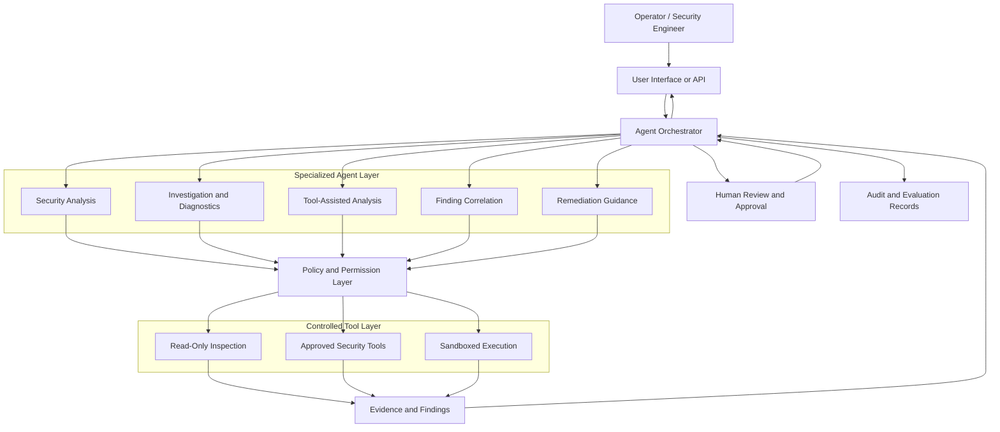

# ANTRAL

### AI-Powered Security Engineering Through Specialized Agents

**Antral** is a security-focused AI multi-agent project designed to explore how specialized AI agents can collaborate on cybersecurity analysis, investigation, and defensive engineering workflows.

Rather than relying on a single general-purpose assistant, Antral aims to organize security work into focused capabilities, coordinated through an architecture that can combine AI reasoning, tools, structured findings, and controlled execution.

> **Project status:** Active development. The capabilities described as goals or architectural principles should not be interpreted as a claim that every feature is already implemented. Refer to the source code and project documentation for the current implementation.

---

## Table of Contents

- [Overview](#overview)
- [Vision and Objectives](#vision-and-objectives)
- [Core Design Principles](#core-design-principles)
- [Planned Security Capabilities](#planned-security-capabilities)
- [Multi-Agent Architecture](#multi-agent-architecture)
- [Security and Trust Boundaries](#security-and-trust-boundaries)
- [Technology and Integrations](#technology-and-integrations)
- [Repository Structure](#repository-structure)
- [Getting Started](#getting-started)
- [Configuration](#configuration)
- [Development Workflow](#development-workflow)
- [Testing and Validation](#testing-and-validation)
- [Responsible Use](#responsible-use)
- [Roadmap](#roadmap)
- [Contributing](#contributing)
- [License](#license)

---

## Overview

Cybersecurity investigations often require several distinct activities: gathering evidence, understanding system behavior, analyzing potential threats, correlating findings, and deciding on appropriate defensive actions.

Antral explores a multi-agent approach to these tasks.

The project is intended to bring together specialized AI capabilities within a coordinated security-engineering workflow. Each agent can focus on a defined responsibility, while a central orchestration layer manages task delegation, context, results, and execution boundaries.

### The problem Antral addresses

Traditional security workflows can involve fragmented tools, repetitive investigation, disconnected findings, and significant manual coordination.

Antral aims to explore how an AI-assisted security system can help by:

- Dividing complex security tasks into smaller, specialized subtasks.
- Coordinating multiple agents around a common objective.
- Using tools and collected evidence to support analysis.
- Producing structured findings that can be reviewed and validated.
- Keeping consequential system actions subject to explicit authorization.
- Maintaining traceability between an investigation, its evidence, and its conclusions.

The long-term objective is a security engineering assistant that can support practical defensive work while remaining observable, controllable, and accountable.

## Vision and Objectives

The long-term vision is to develop a modular AI security team capable of assisting with security assessment, investigation, system diagnostics, and defensive operations.

The principal objectives are:

1. **Specialization** — assign distinct responsibilities to purpose-built agents rather than placing every task in one unrestricted agent.
2. **Coordination** — allow agents to exchange relevant context and combine their findings through an orchestration layer.
3. **Evidence-driven analysis** — prefer verifiable observations, tool outputs, and reproducible checks over unsupported model-generated conclusions.
4. **Controlled execution** — separate recommendations from actions that modify systems or access sensitive resources.
5. **Security by design** — treat permissions, isolation, secrets, and auditability as architectural requirements.
6. **Modularity** — make it possible to add, replace, and test agents and tools independently.
7. **Continuous improvement** — use evaluation results, test cases, and reviewed feedback to improve reliability.

## Core Design Principles

| Principle | Description |
|---|---|
| Least privilege | Give each component only the permissions it needs. |
| Human oversight | Require approval for sensitive or consequential operations. |
| Explicit authorization | Restrict testing and execution to systems and resources the operator is authorized to access. |
| Separation of concerns | Keep orchestration, reasoning, tool execution, and presentation distinct. |
| Evidence before conclusions | Associate findings with their supporting observations wherever possible. |
| Fail safely | Deny unsafe or ambiguous operations by default. |
| Observability | Record relevant task decisions, tool calls, errors, and outcomes. |
| Testability | Make individual agents and workflows independently testable. |

---

## Planned Security Capabilities

The following describes the intended scope of the project. Individual capabilities should be considered implemented only when supported by the current source code and tests.

### 1. Security analysis

Assist with interpreting security-relevant information, investigating suspicious behavior, organizing evidence, and explaining potential risks.

### 2. System diagnostics

Support authorized inspection of system state, configuration, application behavior, and operational problems. Any diagnostic tool should have clearly defined permissions and scope.

### 3. Security tool orchestration

Coordinate approved tools through a controlled interface instead of allowing language-model output to become unrestricted operating-system commands.

### 4. Finding correlation

Combine outputs from specialized agents, identify related observations, and distinguish confirmed evidence from hypotheses or uncertain conclusions.

### 5. Defensive recommendations

Generate actionable remediation guidance, explain the rationale behind recommendations, and identify when additional evidence or human review is required.

### 6. Controlled execution

Where execution capabilities are implemented, enforce allowlists, input validation, permission checks, execution limits, and approval requirements appropriate to the operation.

### 7. Investigation records

Work toward traceable records of task inputs, relevant evidence, agent decisions, tool results, and final findings, with sensitive information handled appropriately.

---

## Multi-Agent Architecture

Antral is designed around the concept of a coordinated team of specialized agents.

The following diagram illustrates the **target architectural model**, not a verified map of every component currently present in the repository.



### Architectural responsibilities

**Operator interface**

Receives authorized requests and presents task progress, evidence, findings, and recommendations.

**Agent orchestrator**

Breaks down tasks, routes work to suitable agents, manages task state, and combines agent results. It should enforce timeouts, resource limits, and predictable error handling.

**Specialized agents**

Handle defined tasks using constrained instructions, relevant context, and explicitly available tools. Agent outputs should be validated before they influence subsequent actions.

**Policy and permission layer**

Determines whether a proposed operation is permitted. Authorization must be enforced by the execution system, not merely requested in an agent prompt.

**Controlled tool layer**

Provides narrowly scoped interfaces for system inspection and approved operations. Potentially dangerous actions should be isolated and subject to additional controls.

**Evidence and findings**

Stores or returns observations and analysis in a structured form. A finding should distinguish raw evidence, interpretation, confidence, and recommended next steps.

**Human review**

Provides a decision point for sensitive operations, remediation, or actions that could disrupt a system.

**Audit and evaluation**

Supports debugging, reproducibility, performance assessment, and investigation of unexpected agent behavior.

---

## Security and Trust Boundaries

An AI security system must account for the possibility that its agents can misunderstand instructions, produce incorrect commands, or encounter malicious content.

Antral's design should treat the language model as an untrusted decision-making component rather than as the ultimate security authority.

### Recommended safeguards

- **Tool authorization:** validate every tool invocation against server-side policies.
- **Command restrictions:** avoid unrestricted shell access; use predefined operations and validated arguments wherever practical.
- **Human approval:** require explicit confirmation for destructive, privileged, or externally consequential operations.
- **Isolation:** execute risky analysis in appropriately restricted environments.
- **Prompt-injection resistance:** treat retrieved files, web pages, tool output, and other external content as untrusted data.
- **Secret management:** keep credentials and API keys outside source control and prevent them from leaking into logs or model context.
- **Input validation:** validate schemas, paths, arguments, file sizes, and resource consumption.
- **Auditability:** record security-relevant decisions and tool outcomes without unnecessarily retaining sensitive data.
- **Failure handling:** use timeouts, bounded retries, cancellation, and safe defaults.
- **Network restrictions:** limit access to external systems and internal network resources according to the task's authorization.
- **Evidence validation:** do not treat an agent's claim that an operation succeeded as proof that it did.

### Security model

A useful distinction is:

1. **Analysis:** interpret information and propose an action.
2. **Authorization:** determine whether that action is permitted.
3. **Execution:** perform the approved operation through a controlled tool.
4. **Verification:** inspect the actual result.
5. **Reporting:** return the evidence, outcome, and remaining uncertainty.

These stages should remain distinct even when a workflow is automated.

---

## Technology and Integrations

Antral's implementation details should be documented directly from the current repository rather than inferred from its project vision.

The following areas should be confirmed against the code before publishing exact dependency claims.

| Area | What to document |
|---|---|
| Agent framework | Actual orchestration and agent libraries |
| Backend | Language, framework, API interface, and runtime |
| Frontend | UI framework and build tooling, if present |
| Model providers | Supported LLM providers and configuration |
| Data storage | Databases, vector stores, caches, and file storage actually used |
| Tool execution | Supported system tools, operating-system interfaces, and isolation mechanisms |
| Observability | Logging, tracing, metrics, and evaluation tools |
| Testing | Unit, integration, security, and end-to-end testing frameworks |

Do not assume that an integration is operational merely because configuration files, a dependency, or a placeholder exist. Document the integrations that can actually be configured and exercised.

---

## Repository Structure

Use the actual directory layout in the repository as the source of truth. A conceptual organization for a modular implementation could look like this:

```text
Antral/
├── README.md
├── docs/
│   ├── architecture.md
│   └── security-model.md
├── agents/
│   ├── analysis/
│   ├── investigation/
│   └── reporting/
├── orchestrator/
├── tools/
├── policies/
├── tests/
└── config/
```

**Important:** This is an illustrative structure, not a claim that these directories already exist. Replace it with the real repository tree before publishing the final documentation.

---

## Getting Started

Because the repository's current dependency manifests, setup scripts, and required services have not been verified here, installation commands should be taken from the actual project files.

### Prerequisites

Confirm the following based on the implementation:

- Supported operating system and runtime versions.
- Required language runtimes and package managers.
- Required model-provider credentials, if applicable.
- Required databases, caches, or external services, if applicable.
- Any security tools or isolated execution environment required by the project.

### Installation

Clone the repository:

```bash
git clone https://github.com/AbdullahAshfaq77/Antral.git
cd Antral
```

Next, follow the installation instructions for the actual package manifests and service definitions in the repository.

Before documenting exact setup commands, verify the dependency installation, configuration, database initialization, and startup steps against the current code.

### First run

A successful first-run guide should explain how to:

1. Configure the required environment variables.
2. Start the required services.
3. Launch the application and its agent components.
4. Submit a harmless, read-only test task.
5. Inspect the output and any generated logs.
6. Confirm that unauthorized operations are rejected.

---

## Configuration

Configuration should be documented using the actual environment-variable names and configuration files used by the codebase.

A complete configuration reference should identify:

| Configuration category | Documentation needed |
|---|---|
| Model provider | Provider selection, model identifier, and credential requirements |
| Agent orchestration | Task limits, timeouts, and retry behavior |
| Storage | Connection settings and data-retention requirements |
| Security tools | Executable paths, permissions, and approved operations |
| Isolation | Sandbox configuration and resource limits |
| Logging | Log level, redaction, and retention |
| External integrations | Required endpoints, credentials, and network permissions |

Provide an example environment file containing placeholders only. Never publish real API keys, tokens, passwords, database credentials, or private certificates.

For every setting, document whether it is required, its default value, and its security implications. Do not create configuration variables that the application does not actually read.

---

## Development Workflow

A disciplined development process helps keep a multi-agent security system maintainable.

### Adding an agent

A new agent should have:

1. A clearly defined responsibility and scope.
2. Explicit input and output schemas.
3. A documented set of permitted tools.
4. Defined failure, timeout, and cancellation behavior.
5. Tests for expected and adversarial inputs.
6. Validation of its output before downstream use.
7. Documentation of its permissions and limitations.

### Adding a tool

A tool should expose a narrow, typed interface rather than unrestricted access to the host.

Before integrating it, establish:

- Which operations are allowed.
- Which resources it can access.
- How arguments are validated.
- Whether execution can change system state.
- What approval is required.
- How output is bounded and sanitized.
- How execution is logged and verified.

### Changes to orchestration

Changes to task routing, agent collaboration, shared context, or execution policy should be tested against both normal workflows and failure scenarios.

---

## Testing and Validation

Security-related AI systems need more than successful example conversations. Their behavior must be tested under incorrect assumptions, malicious inputs, unavailable services, and unauthorized requests.

Recommended test categories include:

| Test category | Purpose |
|---|---|
| Unit tests | Validate agent logic, parsers, schemas, and policy decisions. |
| Integration tests | Verify communication between agents, services, and tools. |
| Authorization tests | Confirm that restricted operations are denied. |
| Prompt-injection tests | Test handling of malicious instructions embedded in external content. |
| Tool-validation tests | Reject invalid arguments, unsafe paths, and unsupported operations. |
| Failure tests | Check behavior when a model, tool, or service becomes unavailable. |
| Regression tests | Detect changes in previously evaluated behavior. |
| End-to-end tests | Verify complete workflows from request to evidence-backed result. |

### Evaluation criteria

Evaluate the system using measurable outcomes such as:

- Task completion rate.
- Accuracy of findings.
- Evidence coverage.
- Unsupported-claim rate.
- Incorrect tool-call rate.
- Unauthorized-action rejection rate.
- Latency and resource consumption.
- Reproducibility of results.

Any performance or accuracy figures published in the README should be backed by reproducible tests and a documented evaluation method.

---

## Responsible Use

Antral is intended for legitimate security engineering, defensive investigation, authorized assessment, and controlled experimentation.

Users are responsible for ensuring they have permission to examine systems, access data, and execute security tools.

- Test only within an explicitly authorized scope.
- Use isolated environments for potentially risky experiments.
- Review consequential recommendations before acting on them.
- Do not expose secrets or sensitive production data to model providers without appropriate authorization.
- Verify findings independently before treating them as confirmed vulnerabilities.
- Follow applicable laws, organizational policies, and responsible disclosure practices.

AI-generated security findings can be incomplete, incorrect, or misleading. Antral should complement qualified human judgment rather than replace it.

---

## Roadmap

The following is a proposed development roadmap. It is not a statement that these milestones are already complete.

- [ ] Document the current architecture and agent responsibilities.
- [ ] Establish typed, validated interfaces for agent inputs and outputs.
- [ ] Define a centralized, testable authorization policy.
- [ ] Implement or verify controlled tool execution and isolation.
- [ ] Add structured findings with evidence and confidence information.
- [ ] Add human approval for sensitive operations.
- [ ] Establish unit, integration, and security regression tests.
- [ ] Add traceable task and tool-execution records.
- [ ] Build a repeatable evaluation suite for agent reliability.
- [ ] Document installation, configuration, and troubleshooting from the actual implementation.
- [ ] Expand specialized security workflows as they are implemented and tested.

---

## Contributing

Contributions should improve reliability, security, clarity, or maintainability.

Before contributing:

1. Review the existing implementation and project conventions.
2. Open an issue or discussion for substantial architectural changes.
3. Keep changes focused and provide tests for new behavior.
4. Avoid committing secrets, credentials, private data, or generated artifacts that should remain untracked.
5. Document new configuration, permissions, tools, and dependencies.
6. Explain security implications when a change expands an agent's capabilities.

For security-sensitive findings, use a responsible disclosure process rather than publishing exploitable details before maintainers have had an opportunity to respond.

---

## License

The applicable license should be identified from the repository's `LICENSE` file.

If the repository does not yet contain a license, clarify the intended licensing terms before claiming that the project is open source or granting reuse permissions.

---

## Project

**Antral — AI Security Multi-Agent Team**

Repository: [github.com/AbdullahAshfaq77/Antral](https://github.com/AbdullahAshfaq77/Antral)

Built around a central idea: make AI-assisted security work more modular, evidence-driven, controlled, and auditable.

